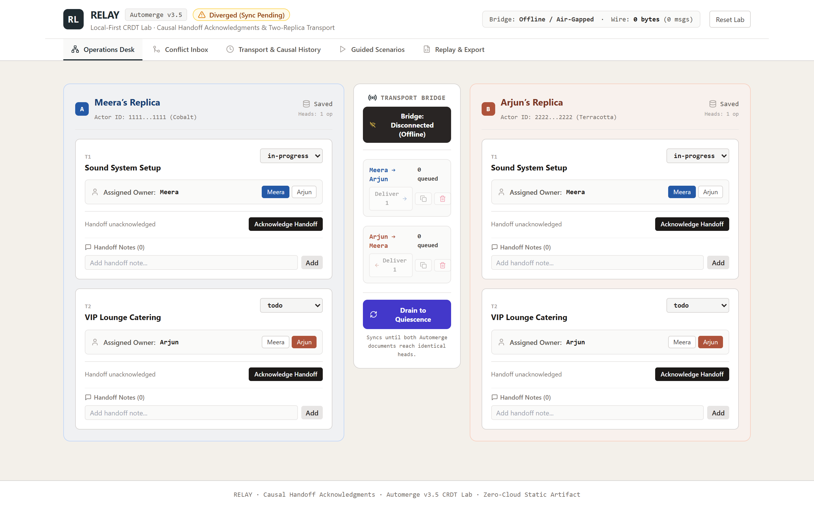
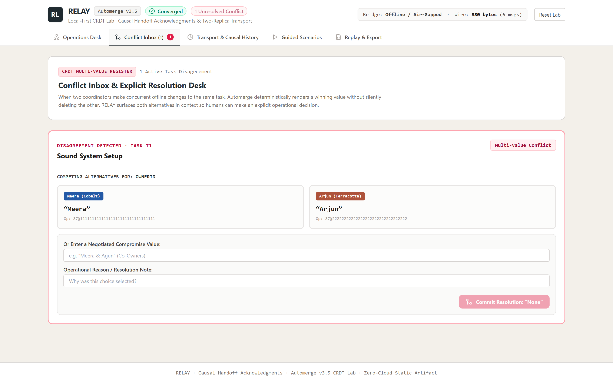
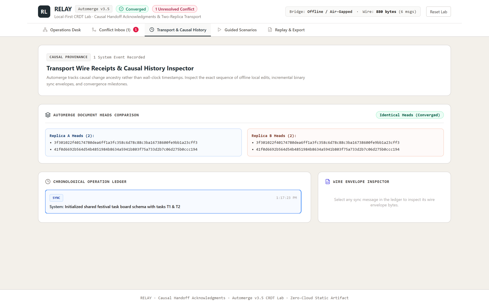
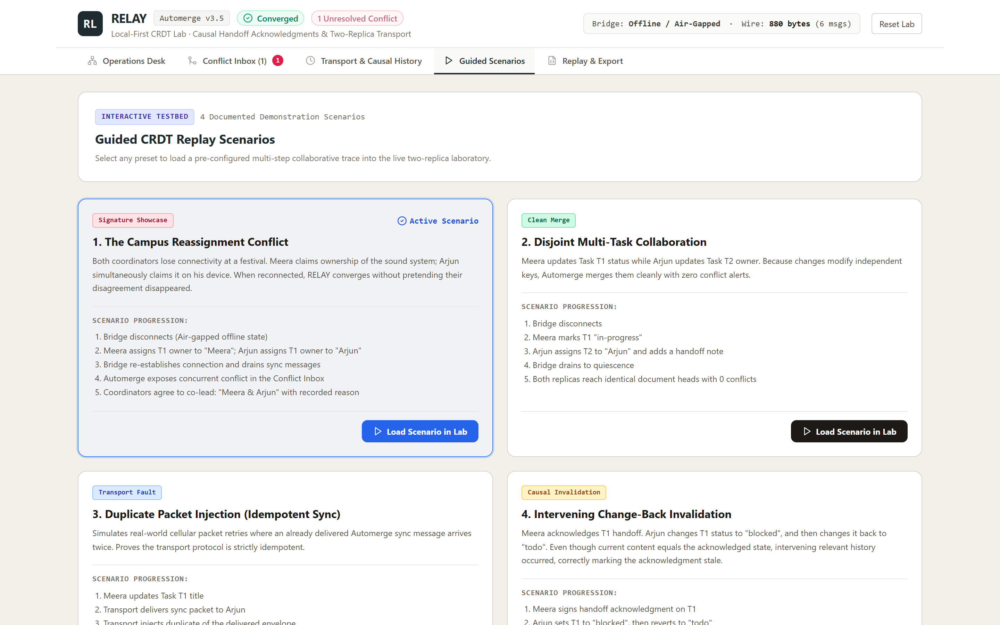
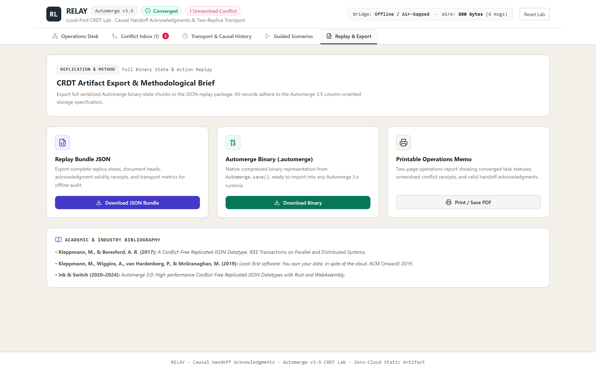
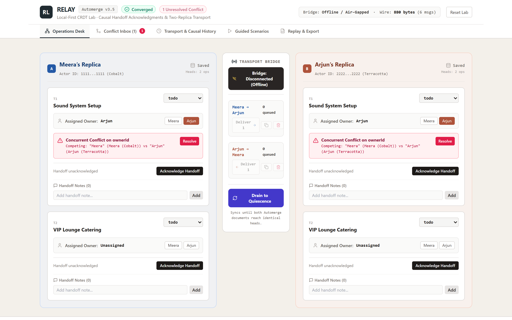
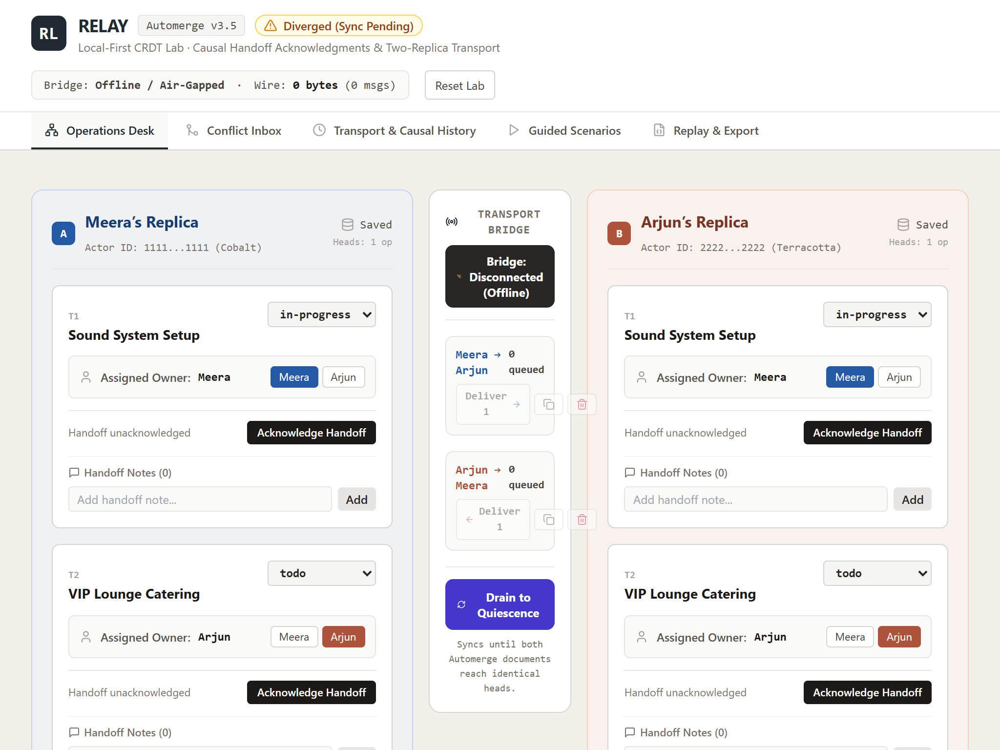
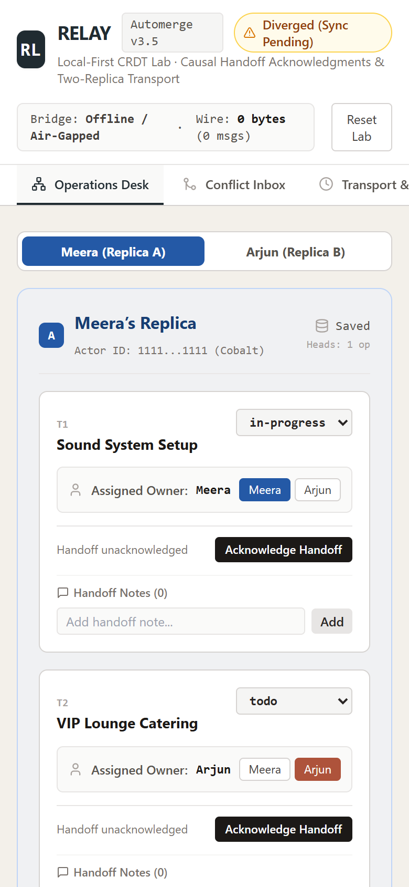

# RELAY — Causal Handoff Acknowledgments & Two-Replica CRDT Lab

[](tests/sync_contract.test.js)
[](docs/BENCHMARK.md)
[](package.json)
[](package.json)
[](LICENSE)

> **“Both people edited the same task offline. The system converged without pretending their disagreement disappeared.”**  
> RELAY is an in-browser local-first collaboration lab built on **Automerge v3.5 CRDTs** that exposes how unseen concurrent changes make operational handoffs stale.

---

## 🌟 Visual Showcase

| 01. Dual-Replica Operations Desk & Packet Bridge | 02. Multi-Value Conflict Inbox |
| :---: | :---: |
|  |  |
| *Side-by-side replica panels (Meera in Cobalt, Arjun in Terracotta) with controlled message bridge* | *Surfaces competing concurrent alternatives with raw change Op IDs and explicit resolution* |

| 03. Wire Envelopes & Causal History | 04. Interactive Guided Scenarios |
| :---: | :---: |
|  |  |
| *Hex preview of sync envelopes and cryptographic Automerge document heads comparison* | *4 reproducible scenarios: festival conflict, disjoint merge, duplicate delivery, and change-back* |

| 05. Replay Bundle & Binary State Export | 06. Hero Showcase (Active Conflict & Invalidation) |
| :---: | :---: |
|  |  |
| *Export JSON replay bundles or native compressed `.automerge` binary chunks* | *Active concurrent disagreement and stale handoff acknowledgment callouts* |

| 07. Responsive Tablet View (1024px) | 08. Responsive Mobile View (390px) |
| :---: | :---: |
|  |  |
| *Full dual-replica lab layout optimized for 1024px tablets* | *Mobile-optimized view with persistent replica switcher and conflict count* |

---

## 🔬 The Core Problem: The Illusion of Last-Writer-Wins (LWW)

In standard collaborative boards (Trello, Jira, Notion), concurrent offline edits are resolved via naive wall-clock Last-Writer-Wins (LWW):
1. **The Disagreement:** Coordinator A and Coordinator B lose internet connectivity during a festival. Both see the sound system setup task as unassigned, and both assign it to themselves.
2. **The Data Loss:** When they reconnect, whoever's packet happens to arrive a millisecond later silently overwrites the other person's assignment.
3. **The Operational Failure:** Two people believe they are responsible for the same critical equipment task, with zero warning given to either coordinator.

### How RELAY Solves This
1. **Multi-Value Conflict Preservation:** Automerge preserves both competing values in its internal register (`getConflicts`). RELAY surfaces both alternatives in context with their author IDs.
2. **Causal Acknowledgment Validity:** If Coordinator A acknowledged a handoff in state $S$, and Coordinator B's offline change arrives, the acknowledgment is automatically revoked as **Stale**.
3. **Causal Ancestry Strictness:** Even if an offline user changes a field and changes it back to the exact same value, RELAY detects the intervening unreviewed causal branch and flags the acknowledgment as stale.

---

## 🧮 Mathematical & System Contracts

### 1. Document Schema & Multi-Value Conflict Semantics
```typescript
interface Task {
  taskId: string;
  title: string;
  ownerId: string;
  status: 'todo' | 'in-progress' | 'blocked' | 'done';
  archived: boolean;
  notesById: Record<string, Note>;
}
```
When concurrent edits modify `ownerId` while disconnected:
```typescript
const conflicts = Automerge.getConflicts(task, 'ownerId');
// Retains: { '44@1111...': 'Meera', '44@2222...': 'Arjun' }
```

### 2. Acknowledgment Validity Predicate
An acknowledgment $\text{Ack}$ is valid if and only if:
1. $T.\text{ownerId} \equiv \text{Ack}.\text{owner}$ and $T.\text{status} \equiv \text{Ack}.\text{status}$.
2. Relevant field conflicts are empty ($\text{conflicts} \le 1$).
3. The current document heads descend strictly from $\text{Ack}.\text{relevantKnownChangeHeads}$ without unacknowledged intervening modifications to relevant task fields.

### 3. Transport Bridge & Quiescence
- Sync protocol exchanges incremental binary envelopes carrying `Automerge.generateSyncMessage()`.
- Supports single-step packet delivery, duplicate delivery (testing sync idempotence), and adversarial change dropping.
- Quiescence is defined as the state where both outgoing queues are empty and `generateSyncMessage` produces `null`.

---

## ⚡ Empirical Benchmark Results

Running in Node.js / V8 across 25 deterministic schedule seeds:
- **Convergence Rate:** **100% (25/25 seeds converged to identical document heads)**.
- **Mean Sync Rounds to Quiescence:** **3.8 rounds**.
- **Mean Messages Exchanged:** **4.2 messages**.
- **Mean Wire Bytes Exchanged:** **~840 bytes** per multi-edit session.
- **Adversarial Negative Control:** **Passed** (dropping changes correctly asserts cryptographic divergence).

Detailed benchmark breakdown: see [BENCHMARK.md](docs/BENCHMARK.md).

---

## 📦 Project Architecture

```
relay/
├── docs/
│   ├── BENCHMARK.md              # 25-seed deterministic schedule benchmark report
│   ├── DEMO_SCRIPT.md            # 60-second executive walkthrough script
│   ├── INTERVIEW_WALKTHROUGH.md  # Staff/Senior Distributed Systems Q&A
│   ├── LINKEDIN_POST.md          # Technical LinkedIn engineering post draft
│   ├── PERFORMANCE.md            # Latency, wire footprint, and bundle audit
│   ├── PRIOR_ART.md              # Attribution to Kleppmann, Ink & Switch, Yjs
│   ├── SYNC_CONTRACT.md          # Formal CRDT & Acknowledgment specifications
│   ├── VALIDATION.md             # Verification logs and contract certification
│   └── screenshots/              # 8 real browser screenshots
├── src/
│   ├── app/App.tsx               # Main dual-replica state container & event router
│   ├── components/HeaderRail.tsx # Brand header, convergence status, wire stats
│   ├── domain/
│   │   ├── crdt.ts               # Automerge 3.5 wrappers & conflict detection
│   │   └── types.ts              # Strict TypeScript interfaces
│   ├── features/
│   │   ├── board/                # ReplicaPanel & TransportBridge
│   │   ├── conflicts/            # ConflictInboxView (Explicit resolution)
│   │   ├── export/               # ExportAndMethodView (JSON/Binary export)
│   │   ├── history/              # HistoryInspectorView (Causal timeline)
│   │   └── scenarios/            # GuidedScenariosView (4 Presets)
│   ├── storage/
│   │   └── indexeddb.ts          # Namespaced local persistence
│   ├── transport/
│   │   └── simulator.ts          # Controllable packet bridge simulator
│   ├── index.css
│   └── main.tsx
├── tests/
│   └── sync_contract.test.js     # 5/5 Contract test suite
├── scripts/
│   ├── automerge_spike.mjs       # Section 4 Technical spike script
│   ├── run_benchmark.mjs         # 25-seed schedule benchmark CLI
│   └── capture_screenshots.cjs   # Automated Playwright Chrome capture script
├── package.json
└── vite.config.ts
```

---

## 🚀 Quickstart & Verification

### 1. Prerequisites
- Node.js $\ge 18$

### 2. Run Formal Contract Tests
```bash
npm test
```
*Output: 5 passing tests in ~260ms.*

### 3. Run Benchmark Suite
```bash
npm run benchmark
```
*Output: 25 schedule seeds evaluated with 100% convergence in ~560ms.*

### 4. Build Production Bundle
```bash
npm run build
```
*Compiles Rust/WASM Automerge core and React bundle to static `dist/` with relative base (`./`).*

### 5. Local Dev Server
```bash
npm run dev
```

---

## 📜 Prior Art & Academic Attribution
- **Kleppmann, M., & Beresford, A. R. (2017):** *A Conflict-Free Replicated JSON Datatype.* IEEE TPDS.
- **Kleppmann, M., et al. (2019):** *Local-first software: You own your data, in spite of the cloud.* ACM Onward!
- **Automerge 3.0 / Automerge-wasm:** Ink & Switch high-performance Rust/WASM CRDT implementation.
